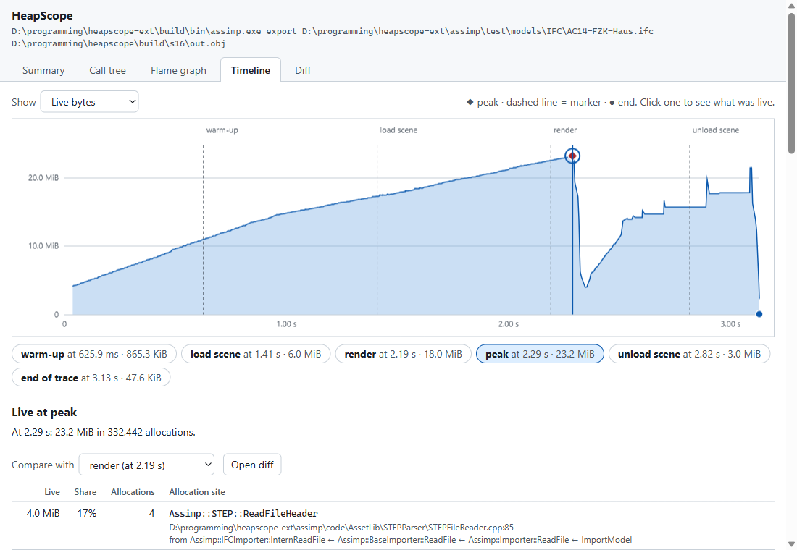
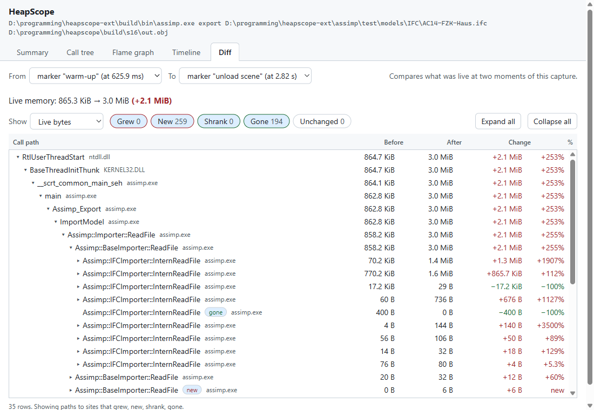

# Reading leak, diff and HTML reports

This explains what HeapScope's leak candidates and snapshot diffs mean, and how to silence the
ones you know are fine. `heapscope analyze` prints the leak report (`--suppressions FILE` adds your own rules,
`--no-builtin-suppressions` turns the built-in ones off), and `heapscope diff` compares traces.

## Leak candidates

A leak candidate is an allocation that was still live when the trace ended. That is evidence of a
leak, not proof: a program may keep a cache or singleton alive until exit on purpose.

Candidates are grouped by **call path** (the allocation site and its callers, with allocator and C
runtime frames hidden) and by **kind of object**:

| Kind | What it is |
|---|---|
| `heap` | `malloc`, `new`, `HeapAlloc` and friends |
| `pool` | memory from a custom pool or arena registered through the C API |
| `virtual` | `VirtualAlloc` reservations (the format has it; `heapscope run` does not record them yet) |
| `handle` | kernel handles opened and never closed (the format has it; not recorded yet) |

Candidates are listed largest first. Each shows how many allocations are live, their total size,
and when the oldest and newest of them were made.

### How the capture mode changes the meaning

- **Full capture (`heapscope run`)**: "live at exit". If the capture did not shut down cleanly
  (the process was killed), the report says so, and "exit" means where the trace stops.
- **Attached capture (`heapscope attach`)**: allocations made before the attach are not tracked,
  so what is live is **net growth since attach**, not leaks. The report is titled accordingly.
  Frees of memory allocated before the attach are expected and are not errors.
- **Sampled capture (`--sample N`)**: counts and sizes are multiplied by N and labelled
  **estimated**. Each allocation is kept with probability 1/N, so a site with many allocations is
  accurate to about `1 / sqrt(allocations kept)` (a few percent for tens of thousands of
  allocations), while a small site or a small leak is noisy or missed entirely: a sampled trace
  cannot show that a program is leak free. Live bytes and the peak are estimates too. Handle
  counts are never sampled and are not scaled.

Lost events skew the picture too: a lost free looks like a leak, a lost allocation hides one. The
report warns when the capture buffers overflowed.

## Suppressions

Some memory is meant to live until exit. Reporting it buries the real leaks, so HeapScope sets
aside call paths that match a suppression rule. Suppressed entries are not deleted: they are
listed separately with the rule that matched and the reason, so you can check the rule.

### Built-in rules

These cover work done before `main` and by the loader, which the program never frees:

- global object construction and teardown (`dynamic initializer for ...`, `dynamic atexit
  destructor for ...`, `_initterm`, `_cinit`)
- C runtime start-up (`__acrt_initialize`, `__vcrt_initialize`, `__scrt_initialize_*`,
  `dllmain_crt_process_attach`, `__dyn_tls_init`)
- standard library tables kept for the process lifetime (`std::_Init_locks`,
  `std::ios_base::Init`, locale initialisation)
- Windows loader bookkeeping (`Ldrp*`, `LdrInitializeThunk`, `LdrLoadDll`)

The built-in rules are deliberately narrow. They do not hide a whole system DLL, because every
thread's call path starts in `ntdll.dll`.

### Your own rules

A suppression file has one rule per line. A rule matches a call path if **any** frame of the path
matches. `#` starts a comment; the comment on a rule is shown as its reason.

```text
# Library singletons that live until exit
fn:cv::getInitializationMutex      # OpenCV creates this on first use and never frees it
module:opencv_world*.dll
file:*/third_party/*
```

- `fn:` matches the function name as it appears in the report
- `module:` matches the module file name
- `file:` matches the source path; `/` and `\` are interchangeable

Patterns are case-insensitive. `*` matches any run of characters and `?` matches one.

A function-local static (`static Foo& get() { static Foo f; return f; }`) is created on first use
inside your own code, so no built-in rule can tell it from a leak. Add a rule for it by name.

## Snapshot diff

`heapscope diff before.hstrace after.hstrace` compares what is live at the end of each trace.
`heapscope diff trace.hstrace --markers start stop` compares two markers inside one trace
(`@end` stands for the end of the trace).

| Label | Meaning |
|---|---|
| `new` | nothing live at that site before, something live now |
| `grew` | more live bytes (or the same bytes in more allocations) |
| `shrank` | fewer live bytes |
| `gone` | live before, nothing live now |

Sites are matched by **symbol, not address**: the module and function name of each frame, the
innermost 12 by default (`--depth`). Addresses move between runs and line numbers move between
builds, so neither is used. Two paths that only differ beyond the matched depth are merged.

Things to know when reading a diff:

- A site with no symbols is identified as `module+0xoffset`. That only matches between runs of the
  same build.
- Attached and sampled traces keep their caveats (see above); the diff prints a note for each.
  Sampled sides are scaled to estimates, and two traces sampled at different rates are flagged.
- `--min-change BYTES` hides small differences; `--all` also lists unchanged sites.

## The HTML report

`heapscope report trace.hstrace -o report.html` (or `analyze --html`) writes one offline page with
these tabs: Summary, Call tree, Flame graph, Timeline and Diff. The capture-mode banner (attached,
sampled, filtered, events lost) stays above every tab.

### Timeline



*The markers in this screenshot were added by hand for illustration.*

The chart shows live memory over time (switch to live allocations with **Show**). Dashed lines are
markers set by the program, the diamond is the peak and the dot is the end of the trace.

The report keeps the live set only at those moments, so click a marker, the peak or the end (or
pick it from the list under the chart) to see which allocation sites held the memory then. Clicking
empty space only shows the figures for that point in the tooltip. **Open diff** compares the
selected moment with another one.

### Diff tab



The Diff tab compares the live set at two moments of the capture. The delta tree shows the call
paths down to the sites that changed, with live memory before, after and the change. The filters
(**Grew**, **New**, **Shrank**, **Gone**, **Unchanged**) apply to allocation sites, the nodes that
hold memory themselves; a parent row stays visible when something below it matches, and its
numbers include everything below it. A red `+` change is more memory, a green `−` less (the sign
is always in the text). **Show** switches between live bytes and live allocations.

To compare two runs, write a diff report: `heapscope diff before.hstrace after.hstrace --html
diff.html`, or `heapscope diff trace.hstrace --markers start stop --html diff.html`. It has a
Summary tab (totals and the changed sites, as `heapscope diff` prints them) and the same delta
tree. The two call trees are merged on module and function names, so they match across builds.
